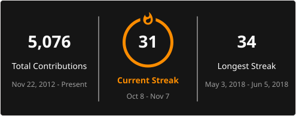

  

&nbsp;

<h2 align="left">⭐ Top Projects:</h2>

<h3>🧩 Components</h3>

    &nbsp;
    &nbsp;
    &nbsp;
    &nbsp;
    

<h3>📚 Libraries</h3>

    &nbsp;
    &nbsp;
    &nbsp;
    &nbsp;
    &nbsp;
    &nbsp;
    >&nbsp;
    &nbsp;
    &nbsp;
    &nbsp;
    &nbsp;
    &nbsp;
    

<h3>🏠 Self-Hosted</h3>

    &nbsp;
    &nbsp;
    &nbsp;
    &nbsp;
    &nbsp;
    &nbsp;

<h3>🛠️ Tools</h3>

    &nbsp;
    &nbsp;
    

<h3>📦 Other</h3>

    &nbsp;
    

StackOverflow Reputation: 

    

## Support

If you like my work, consider supporting me.

  &nbsp;&nbsp;&nbsp;
  

  Prefer using your phone? Scan the QR code:

  

